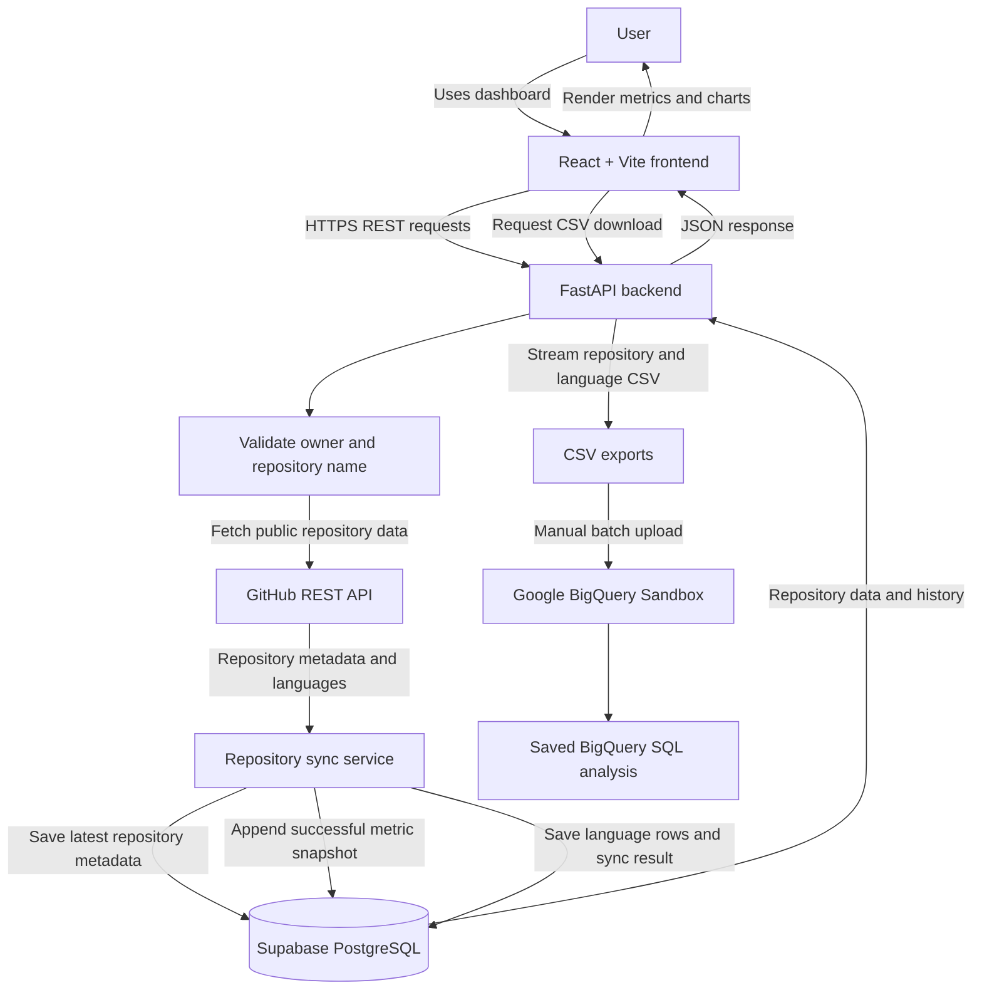
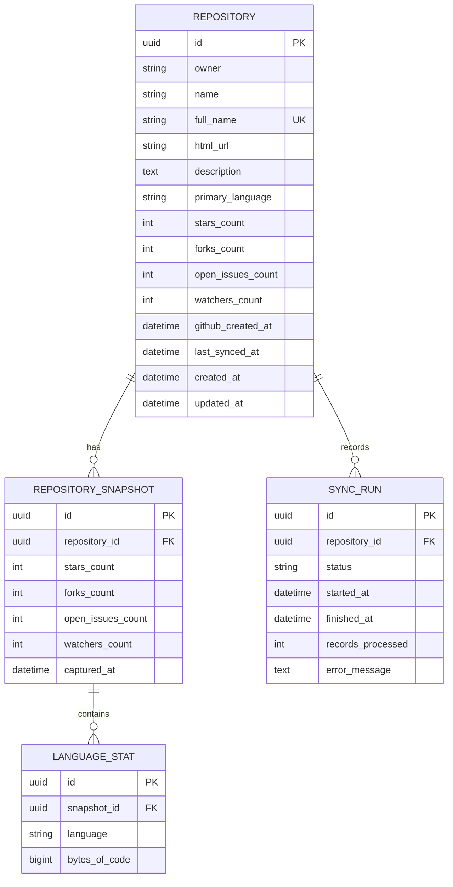

# RepoPulse — Implementation Plan

## Summary

RepoPulse is a single-user dashboard for tracking public GitHub repositories over time. A user adds a repository by owner and name, the backend validates it against the GitHub REST API, stores its current metadata, and appends an immutable snapshot of its star/fork/issue/watcher counts plus its language breakdown on every successful sync.

The dashboard shows aggregate metrics across tracked repositories; the detail page plots historical stars and forks and shows language composition. Every sync attempt — successful or failed — is recorded, so a rate-limited or failed fetch never corrupts the metric history. Two CSV export endpoints produce flat files that can be uploaded into a BigQuery Sandbox dataset for ad-hoc SQL analysis.

There is no authentication, no background scheduler, and no webhook ingestion. Syncs are manual and user-triggered. The goal is a complete, maintainable end-to-end flow rather than a production-grade data platform.

## Tech stack

### Backend
- Python 3.11+
- FastAPI — REST endpoints and generated OpenAPI docs
- SQLAlchemy 2.x (declarative, typed `Mapped[...]` models) — PostgreSQL access
- Alembic — schema migrations
- Pydantic v2 / pydantic-settings — request, response and config validation
- `httpx` — async GitHub REST API client
- `pytest` + `httpx.ASGITransport` — backend tests with GitHub calls mocked

### Frontend
- React 18 + Vite
- TypeScript
- React Router for page navigation
- Native `fetch`, wrapped in a thin `src/api/client.ts` (one HTTP approach, used consistently)
- Recharts for the history line chart and the language bar chart
- Plain CSS (one stylesheet, CSS custom properties) — no design system

### Database and external services
- PostgreSQL, hosted on the Supabase free plan (psycopg 3 driver)
- GitHub REST API — public repository metadata and language statistics only
- Google BigQuery Sandbox — optional, batch CSV upload only, never a runtime dependency
- Render free web service (backend) + Render static site (frontend)
- GitHub Actions for CI

## Architecture



Request layering, outermost to innermost:

1. **`app/api/v1/*`** — routers. Parse and validate input, map domain errors to HTTP status codes, serialise through Pydantic response schemas. No GitHub or SQL logic here.
2. **`app/services/*`** — the sync service and the export service. All transactional and business rules live here: duplicate detection, snapshot creation, sync-run bookkeeping, CSV row generation.
3. **`app/services/github.py`** — the only code that talks to GitHub. Translates HTTP failures into typed `GitHubError` subclasses (`RepositoryNotFound`, `RateLimited`, `UpstreamUnavailable`) so the layers above never inspect raw responses.
4. **`app/models/*`** — SQLAlchemy ORM models with cascade rules; `app/db/session.py` owns the engine and the `get_db` dependency.

The sync flow is deliberately fail-safe: a `SyncRun` row is created with status `in_progress` and committed *before* GitHub is contacted, so a crash mid-sync leaves evidence. Only after both GitHub calls succeed does the service write the repository update, the snapshot and the language rows in a single transaction and mark the run `success`. Any `GitHubError` marks the run `failed` with a sanitised message and raises — no snapshot is written.

## Data model



Rules carried into the schema:

- UUID primary keys, server-side `gen_random_uuid()` defaults, all timestamps `TIMESTAMPTZ` in UTC.
- `repository.full_name` is `owner/name` and carries a unique constraint. Duplicate detection is case-insensitive: a functional unique index on `lower(full_name)` backs it, and the service normalises before querying.
- `repository_snapshot` is append-only — one row per successful sync, never updated.
- `language_stat` hangs off the snapshot, not the repository, with a unique constraint on `(snapshot_id, language)`.
- `sync_run.status` is a `VARCHAR(32)` carrying a `CHECK` constraint limiting it to `in_progress`, `success`, `failed`.
- Every child table cascades on repository delete (`ondelete="CASCADE"` plus ORM-level `cascade="all, delete-orphan"`), so deleting a repository removes its snapshots, language rows and sync history.
- Indexes on `repository_snapshot(repository_id, captured_at)`, `sync_run(repository_id, started_at desc)` and `language_stat(snapshot_id)`.
- No `USER` table — the app is explicitly single-user.

## Folder structure

```text
repopulse/
├── frontend/
│   ├── src/
│   │   ├── api/            client.ts, repositories.ts, types.ts
│   │   ├── charts/         MetricsHistoryChart.tsx, LanguageBreakdownChart.tsx
│   │   ├── components/     KpiCard, RepositoryList, AddRepositoryForm,
│   │   │                   SyncHistory, ConfirmDialog, ErrorBanner, Loading, EmptyState
│   │   ├── pages/          DashboardPage, RepositoryDetailPage, AnalyticsHelpPage
│   │   ├── App.tsx, main.tsx, styles.css
│   ├── index.html
│   ├── package.json
│   ├── tsconfig.json
│   ├── vite.config.ts
│   ├── .env.example
│   └── README.md
├── backend/
│   ├── app/
│   │   ├── api/            deps.py, v1/{repositories,analytics,exports}.py
│   │   ├── core/           config.py, errors.py, logging.py
│   │   ├── db/             base.py, session.py
│   │   ├── models/         repository.py, snapshot.py, language_stat.py, sync_run.py
│   │   ├── schemas/        repository.py, snapshot.py, analytics.py, common.py
│   │   ├── services/       github.py, sync_service.py, repository_service.py, export_service.py
│   │   └── main.py
│   ├── alembic/            env.py, versions/0001_initial_schema.py
│   ├── tests/              conftest.py, test_health.py, test_repositories.py,
│   │                       test_sync.py, test_exports.py, test_analytics.py
│   ├── alembic.ini
│   ├── requirements.txt
│   ├── pytest.ini
│   └── Dockerfile
├── analytics/
│   └── bigquery/           README.md, repository_trends.sql, language_popularity.sql
├── .github/workflows/ci.yml
├── .env.example
├── .gitignore
├── PLAN.md
└── README.md
```

## Task list

1. Scaffold `backend/` with config, logging, error types and the FastAPI app factory; add `/health` reporting API plus database connectivity.
2. Define the four SQLAlchemy models with cascades, constraints and indexes; wire `app/db/session.py`.
3. Write the Alembic environment and the single initial migration creating the enum, four tables, the case-insensitive unique index and the supporting indexes.
4. Write the GitHub client: bounded timeout, bounded retry on transient failures only, `GITHUB_TOKEN` optional, typed errors for 404 / 403-rate-limit / 5xx / malformed / timeout.
5. Write `repository_service` (create with initial sync, list with `q` search, detail with latest languages, delete) and `sync_service` (sync-run bookkeeping, snapshot + language persistence).
6. Add the `/api/v1/repositories*` routers with the full status-code contract (404 / 409 / 422 / 429 / 502) and a consistent JSON error shape.
7. Add `/api/v1/analytics/summary` and the two streaming CSV export endpoints with stable headers and ISO-8601 UTC timestamps.
8. Write pytest suite against SQLite-in-a-file with a mocked GitHub transport: health, add valid/invalid/duplicate, sync creates exactly one snapshot plus language rows, failed sync records a failure and writes no snapshot, list/search/detail/history/delete, both CSV exports, analytics summary.
9. Scaffold `frontend/` (Vite + React + TS + Router + Recharts), the typed API client and the shared styles.
10. Build the Dashboard page: KPI cards, add-repository form with client-side validation, searchable repository list, export buttons, empty state.
11. Build the Repository detail page: metadata, current metrics, history line chart, language chart, **Sync now** with loading/success/error states, recent sync history, delete with confirmation.
12. Build the Analytics help page explaining the CSV → BigQuery Sandbox workflow.
13. Write `analytics/bigquery/` README and the two GoogleSQL script files.
14. Add the GitHub Actions workflow running backend tests and the frontend build.
15. Write `.env.example`, `.gitignore` and the root README (architecture, data model, endpoints, setup, deploy, free-tier limits, verification status).

## Assumptions

- **Project name.** The source file is `repopulse_project_prompt.md` with no number prefix, so the folder and repository are named `repopulse`, taken from the project title rather than the file name.
- **TypeScript on the frontend.** The spec prefers it if it does not slow delivery down; the API surface is small and typing it is cheap, so TypeScript it is.
- **`fetch` over Axios.** One fewer dependency, and the spec asks only that one approach be chosen consistently.
- **Case-insensitive duplicate detection** is implemented (the spec says "if practical") via a `lower(full_name)` unique index. Owner and name are stored with GitHub's own casing, taken from the API response rather than from user input.
- **Tests run against SQLite**, not PostgreSQL, so CI needs no database service. The models therefore avoid Postgres-only column types: UUIDs use SQLAlchemy's dialect-agnostic `Uuid`, and the sync-run status is a `String` column with a `CheckConstraint` rather than a native enum. The migration creates the same checked varchar, so the ORM column type and the real schema cannot drift apart.
- **Snapshot cadence.** Every successful sync writes a snapshot, with no de-duplication window, even when the metrics are identical to the previous one. The spec calls the table append-only history of successful syncs; filtering flat stretches is a reporting concern, not an ingestion one.
- **`records_processed`** on a sync run counts rows written by that run: one snapshot plus one row per language.
- **Retry policy.** Two retries with a short exponential backoff, applied only to timeouts, connection errors and 5xx. A 403 rate-limit response is never retried — it is surfaced as `429` to the client with the reset time when GitHub supplies one.
- **`watchers_count`.** GitHub's REST API returns `watchers_count` as a duplicate of `stargazers_count` and exposes true watchers as `subscribers_count`. The spec explicitly asks for `watchers_count` and that watchers be labelled clearly, so `watchers_count` is what is stored, and the UI labels it "Watchers (GitHub `watchers_count`)" with a note on the detail page.
- **Export scope.** The CSV exports cover all tracked repositories, with no date filtering in this release.
- **CORS** is driven by a comma-separated `FRONTEND_ORIGIN` so local and deployed origins can both be allowed without a wildcard.
- **No Docker requirement.** A backend Dockerfile is included for Render, but local development runs a plain virtualenv.
- **Verification.** Per the loop's ground rules, no dependency was installed and no part of this project was executed. Nothing here has been run, tested or deployed.
